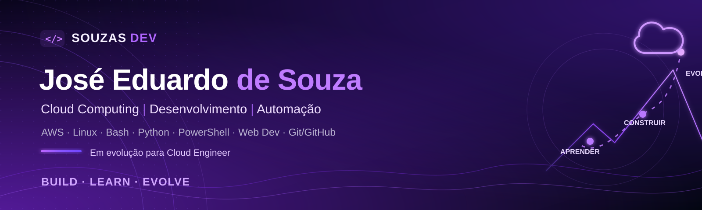

 

### ☁️ Cloud Computing &nbsp;·&nbsp; 💻 Desenvolvimento &nbsp;·&nbsp; ⚙️ Automação

**Estudo, construo projetos e documento minha evolução em tecnologia.**

[Sobre mim](#-sobre-mim) &nbsp;·&nbsp; [Projetos](#-projetos-em-destaque) &nbsp;·&nbsp; [Tecnologias](#-tecnologias-e-ferramentas) &nbsp;·&nbsp; [Minha jornada](#-minha-jornada)

---

## 👋 Sobre mim

Olá! Sou **José Eduardo de Souza**, criador da **Souzas Dev**, minha identidade pessoal na área de tecnologia.

Estou construindo minha trajetória em **Cloud Computing, Desenvolvimento de Software e Automação**. Atualmente, estudo **AWS na Escola da Nuvem** e aprofundo meus conhecimentos em **Linux, Bash, Python, PowerShell, Git/GitHub e desenvolvimento web**.

Gosto de entender como as tecnologias funcionam por dentro: infraestrutura, sistemas operacionais, lógica de programação, estrutura dos códigos e comportamento das aplicações. Uso este GitHub como **portfólio de aprendizagem prática**, com laboratórios, scripts, documentação, resultados e pontos que ainda preciso melhorar.

Minha experiência anterior em **vendas e atendimento ao cliente** complementa essa jornada com comunicação, organização e resolução de problemas.

> 🎯 **Objetivo de longo prazo:** evoluir para **Engenharia de Nuvem (Cloud Engineer)**, construindo uma base consistente em infraestrutura, programação, automação e serviços de nuvem.

## 🚀 Projetos em destaque

Os projetos abaixo representam atividades de estudo e experiências **documentadas**, não produtos comerciais ou comprovação de domínio avançado.

### ☁️ [AWS Lab — Laboratórios de Cloud](https://github.com/Souzas-Dev/AWS-Lab)

Prática com serviços AWS, documentação técnica, scripts e evidências de laboratório.

- **EC2:** provisionamento, instâncias Linux, armazenamento EBS, monitoramento e ciclo de vida.
- **VPC + servidor web:** sub-redes, tabelas de rotas, Security Groups, EC2 e Apache.
- **Abordagem:** organização de evidências, noções de segurança, monitoramento e controle de custos.
- **Status:** laboratório em evolução; a documentação também registra verificações e limitações pendentes.

**Stack:** AWS · Amazon EC2 · VPC · EBS · Amazon Linux · Bash

📁 [Explorar o repositório](https://github.com/Souzas-Dev/AWS-Lab) · [Laboratório EC2](https://github.com/Souzas-Dev/AWS-Lab/tree/main/EC2) · [Laboratório VPC](https://github.com/Souzas-Dev/AWS-Lab/tree/main/VPC)

### 🐧 [Ubuntu Workstation Setup — Linux & Automação](https://github.com/Souzas-Dev/ubuntu-workstation-setup)

Projeto de estudo para automatizar a preparação de um ambiente Ubuntu com ferramentas úteis para desenvolvimento e suporte.

- **Bash:** atualização de pacotes, verificações do sistema e instalação de utilitários.
- **Segurança e qualidade:** modo de simulação (`--dry-run`), registros de execução, tratamento básico de erros e testes Bash.
- **Python:** protótipo experimental de interface com PySide6 (Qt).
- **Status:** versão `v1.2.0` documentada; testes de integração em Ubuntu e validação da interface ainda são pontos de evolução.

**Stack:** Linux · Ubuntu · Bash · Git · Python · PySide6

📁 [Explorar o repositório](https://github.com/Souzas-Dev/ubuntu-workstation-setup) · [Código do script](https://github.com/Souzas-Dev/ubuntu-workstation-setup/blob/main/scripts/setup-ubuntu.sh)

---

## 🛠️ Tecnologias e ferramentas

Organizo meus conhecimentos pelo **tipo de experiência**. Estar listado aqui não significa domínio profissional da ferramenta.

| Experiência prática documentada | Tecnologias e temas |
| :--- | :--- |
| ☁️ **Cloud** | AWS, EC2, VPC, EBS, Security Groups, User Data e CloudWatch |
| 🐧 **Linux & automação** | Ubuntu, Amazon Linux, Bash, APT, scripts, logs e troubleshooting |
| 🐍 **Programação** | Python e protótipo de interface com PySide6 |
| 🌿 **Versionamento** | Git, GitHub, branches, Pull Requests e documentação Markdown |
| ✅ **Boas práticas** | Simulação de comandos, testes Bash, documentação e registro de limitações |

**Em estudo e aprofundamento:** PowerShell, lógica de programação, HTML, CSS, JavaScript, desenvolvimento web, APIs, redes, segurança e fundamentos de engenharia de software.

**Outras tecnologias com as quais já tive contato:** TypeScript, React, Next.js, Node.js, SQL, PostgreSQL, Prisma, Supabase, Vercel, GitHub Pages e ferramentas de testes. O nível de experiência varia conforme a tecnologia e nem todas têm demonstrações públicas neste perfil.

## 🧭 Minha jornada

<table>
  <tr>
    <th align="center">BUILD</th>
    <th align="center">LEARN</th>
    <th align="center">EVOLVE</th>
  </tr>
  <tr>
    <td>Construir laboratórios, scripts e projetos pessoais.</td>
    <td>Compreender fundamentos, testar hipóteses e documentar erros e soluções.</td>
    <td>Revisar projetos, melhorar práticas e ampliar minha experiência em Cloud &amp; Dev.</td>
  </tr>
</table>

**Agora:** fortalecer fundamentos de infraestrutura, Linux, AWS, programação e automação, aplicando o que estudo em projetos reproduzíveis.

**Porta de entrada profissional:** oportunidades em **Suporte Técnico, Infraestrutura e Cloud Support**, enquanto continuo desenvolvendo minhas habilidades em software.

**Direção de carreira:** **Cloud Engineer**, com visão integrada de infraestrutura, desenvolvimento e automação.

## 📚 Como uso este GitHub

- **Estudo** os conceitos antes de aplicar.
- **Pratico** em laboratórios e projetos de escopo controlado.
- **Documento** decisões, comandos, resultados, dificuldades e limitações.
- **Evoluo** os projetos de forma incremental, buscando entender o que cada alteração faz.

Se você chegou até aqui, fique à vontade para explorar meus repositórios e acompanhar minha evolução.

---

### Souzas Dev

**BUILD · LEARN · EVOLVE**

*Construindo hoje. Aprendendo sempre. Evoluindo a cada projeto.*

[Ver repositórios](https://github.com/Souzas-Dev?tab=repositories)

