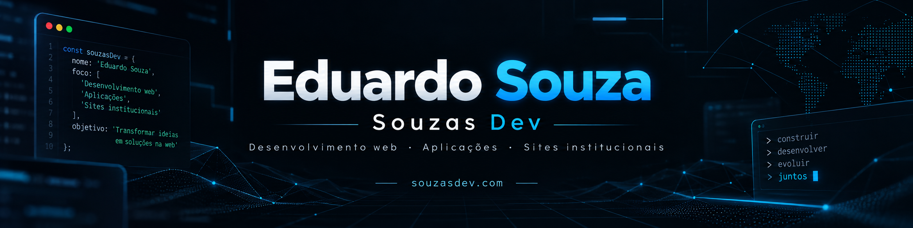
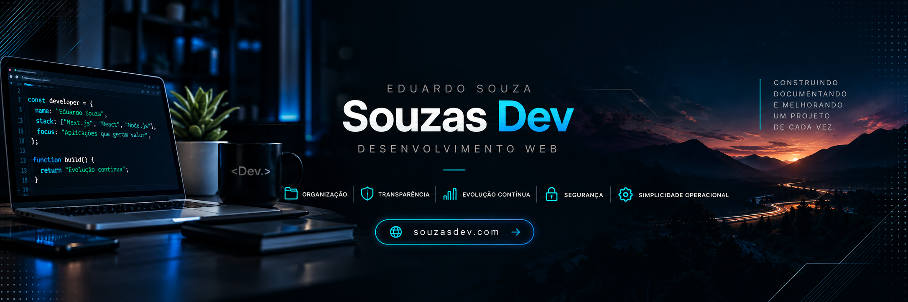



  

Desenvolvimento de aplicações web, sistemas personalizados e experiências digitais.

**Arquitetura · Segurança · Qualidade · Evolução contínua**

[Site oficial](https://souzasdev.com) · [Projetos](#projetos-em-destaque) · [Tecnologias](#tecnologias)

---

## Sobre a Souzas Dev

A **Souzas Dev** é um espaço de desenvolvimento de software dedicado à criação de aplicações web, soluções digitais e produtos próprios.

Trabalho principalmente com **TypeScript, Next.js, React, Node.js e PostgreSQL**, buscando equilibrar experiência de uso, arquitetura, segurança e facilidade de manutenção.

O desenvolvimento é orientado por documentação, testes, versionamento e evolução incremental.

---

## Projetos em destaque

  

### Cartevy CRM

**Status:** Em desenvolvimento

Aplicação de gestão comercial voltada ao acompanhamento de clientes, pedidos, vendas, follow-ups e encomendas.

O projeto conta com persistência PostgreSQL, autenticação server-side, migrations versionadas, testes automatizados e integração contínua.

**Tecnologias:** `Next.js` · `React` · `TypeScript` · `PostgreSQL` · `Prisma` · `Supabase` · `Vitest`

[Ver código e documentação](https://github.com/Souzas-Dev/cartevy-crm)

---

### Estação Café & Prosa

**Status:** Demonstração conceitual

Experiência digital desenvolvida para demonstrar interfaces modernas, responsividade, navegação e interações visuais para uma cafeteria fictícia.

**Tecnologias:** `Next.js` · `React` · `TypeScript` · `CSS`

[Ver demonstração](https://souzas-dev.github.io/estacao-cafe-prosa/) · [Ver código](https://github.com/Souzas-Dev/estacao-cafe-prosa)

---

## Tecnologias

### Desenvolvimento

### Dados e infraestrutura

### Qualidade e ferramentas

---

## Processo de desenvolvimento

Cada projeto evolui conforme suas necessidades, priorizando mudanças rastreáveis e verificáveis.

**Planejamento → Implementação → Testes → Revisão → Integração → Evolução**

As decisões técnicas relevantes são documentadas, incluindo arquitetura, persistência, segurança e limitações conhecidas.

Os projetos conceituais são identificados explicitamente como demonstrações.

---

  

### Vamos construir soluções digitais com propósito.

[Conheça a Souzas Dev](https://souzasdev.com) · [Explore os repositórios](https://github.com/Souzas-Dev?tab=repositories)

**Construindo, documentando e evoluindo um projeto de cada vez.**

