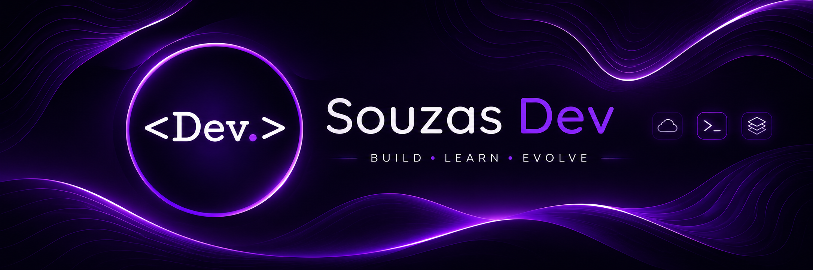

# Eduardo Souza

**Desenvolvimento Web · Cloud Computing · Linux · Automação**

Criador da **Souzas Dev**, minha marca pessoal de tecnologia.

Construindo projetos, explorando novas tecnologias e documentando minha evolução profissional.

**BUILD · LEARN · EVOLVE**

---

## 👋 Sobre mim

Sou Eduardo Souza, entusiasta de tecnologia e desenvolvedor em constante evolução.

A **Souzas Dev** é minha marca pessoal, criada para reunir meus projetos, estudos, experiências práticas e conhecimentos em Tecnologia da Informação.

Atualmente, estou aprofundando meus estudos em **Cloud Computing com AWS**, infraestrutura, Linux, redes e automação, sem deixar de evoluir meus conhecimentos em desenvolvimento web.

Utilizo o GitHub como um portfólio técnico e um registro público da minha jornada de aprendizado.

## 🎯 Áreas de interesse

- **Cloud Computing:** AWS, infraestrutura, redes, segurança e serviços em nuvem.
- **Linux e automação:** administração de ambientes, scripts Bash e diagnóstico.
- **Desenvolvimento web:** frontend, backend e integração de aplicações.
- **Engenharia de software:** Git, documentação, testes e boas práticas.

## 🚀 Projetos em destaque

### ☁️ AWS Labs — Laboratórios Práticos

Laboratórios de computação em nuvem com documentação técnica, scripts e evidências.

**Tecnologias:** AWS · Amazon EC2 · Amazon Linux · Bash · VPC · EBS

**Status:** Em desenvolvimento.

[Explorar AWS Labs](https://github.com/Souzas-Dev/aws-labs)

### 🐧 Ubuntu Workstation Setup

Projeto de automação para preparação de ambientes Ubuntu, com scripts, simulação de execução, logs e testes automatizados.

**Tecnologias:** Linux · Ubuntu · Bash · Git · Python

**Status:** Em evolução.

[Explorar Ubuntu Workstation Setup](https://github.com/Souzas-Dev/ubuntu-workstation-setup)

## 🛠️ Tecnologias e ferramentas

Meu repertório reúne desenvolvimento de aplicações web, bancos de dados, automação e infraestrutura. As ferramentas abaixo representam experiências e estudos em diferentes níveis de familiaridade.

| Área | Tecnologias e ferramentas |
| --- | --- |
| Linguagens | Python · JavaScript · TypeScript · SQL |
| Frontend | HTML5 · CSS3 · React · Next.js · Tailwind CSS |
| Backend | Node.js · APIs e rotas server-side do Next.js |
| Banco de dados | PostgreSQL · Prisma · Supabase |
| Interfaces e automação | PySide6 (Qt) · PowerShell · Bash |
| Sistemas operacionais | Windows · Linux · Ubuntu |
| Qualidade e segurança | Vitest · Zod · ESLint · autenticação e controle de acesso |
| Desenvolvimento e entrega | Git · GitHub · GitHub Actions · Vercel · GitHub Pages |
| Computação em nuvem | AWS · Amazon EC2 · VPC · EBS |

**Em aprofundamento:** AWS, infraestrutura em nuvem, redes, segurança e administração Linux.

O **Windows** faz parte da minha trajetória de longa data com computadores. Hoje também exploro Linux, PowerShell, Bash e Python em projetos práticos.

> A presença de uma tecnologia nesta lista não significa domínio avançado. Procuro demonstrar o que estudei e pratiquei, com transparência sobre o estágio de cada projeto.

## 📚 Aprendizado contínuo

Minha abordagem de aprendizado é baseada em três pilares:

1. **Estudar:** compreender conceitos e fundamentos.
2. **Praticar:** aplicar conhecimentos em projetos e laboratórios.
3. **Documentar:** registrar decisões, resultados, dificuldades e melhorias.

Acredito que a evolução técnica acontece quando transformamos conhecimento em experiência prática.

---

### BUILD · LEARN · EVOLVE

**Souzas Dev**

Marca pessoal de Eduardo Souza.

*Construindo hoje. Aprendendo sempre. Evoluindo a cada projeto.*

