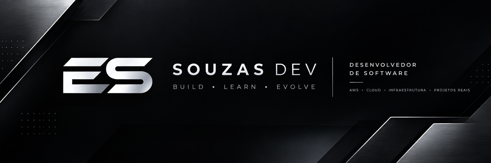

<h3>Eduardo Souza · Desenvolvedor de software</h3>

<h4>Minha marca pessoal. Meus projetos. Minha evolução.</h4>

---

## 👋 Olá, eu sou o Eduardo!

Sou desenvolvedor de software e uso a **Souzas Dev** como minha marca pessoal: um espaço para compartilhar projetos, experiências e o que aprendo pelo caminho.

Gosto de aprender construindo, entender o **porquê** de cada decisão técnica e documentar o processo — não apenas mostrar o resultado final.

## 🎯 Meu foco atual

Estou estudando **AWS e computação em nuvem** e quero transformar esse conhecimento em projetos práticos, com atenção à arquitetura, segurança, automação e custos.

`AWS` · `Cloud Computing` · `Segurança` · `Redes` · `Serverless` · `Automação`

Estou explorando fundamentos de infraestrutura e os serviços que fazem parte dessas soluções, evoluindo dos conceitos para implementações reproduzíveis.

## 🚀 Projetos

> **Portfólio em construção.** Recomecei este GitHub do zero para publicar projetos que demonstrem meu aprendizado na prática. Os itens abaixo são **ideias de estudo**, ainda não entregas concluídas.

| Projeto planejado | O que pretendo demonstrar |
| :--- | :--- |
| **Hospedagem estática na AWS** | S3, CloudFront, permissões e distribuição de conteúdo |
| **API serverless** | API Gateway, Lambda, integração de dados e controle de acesso |
| **Infraestrutura como código** | Provisionamento reproduzível, automação e monitoramento |

À medida que cada projeto estiver pronto, vou incluir aqui o repositório e uma breve explicação das decisões que tomei.

## 🛠️ Tecnologias

Minha base de desenvolvimento inclui:

**Linguagens e web:** `TypeScript` · `JavaScript` · `HTML` · `CSS`

**Frontend e backend:** `React` · `Next.js` · `Node.js`

**Dados e ferramentas:** `PostgreSQL` · `Git` · `GitHub`

**Em estudo:** `Amazon Web Services (AWS)` · arquitetura e infraestrutura em nuvem

Prefiro que as tecnologias apareçam principalmente nos projetos em que forem utilizadas, com contexto e código para demonstrar como foram aplicadas.

## 📚 Aprendizados

Em cada projeto, pretendo registrar:

- **Objetivo:** qual problema ou conceito estou explorando;
- **Arquitetura:** os serviços escolhidos e o motivo das decisões;
- **Implementação:** passos para reproduzir a solução;
- **Segurança e custos:** cuidados tomados durante os testes;
- **Lições aprendidas:** dificuldades, melhorias e próximos passos.

A ideia é que este perfil mostre minha evolução de verdade — incluindo experimentos, ajustes e descobertas.

---

### BUILD · LEARN · EVOLVE

**Build** — Construir para colocar o conhecimento em prática.

**Learn** — Aprender por meio de estudo e experimentação.

**Evolve** — Evoluir a cada novo desafio.

Souzas Dev · Marca pessoal de Eduardo Souza

