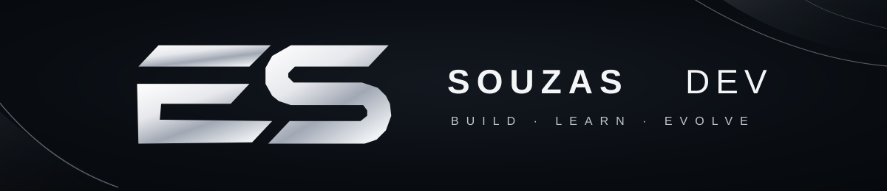



**Eduardo Souza | Desenvolvedor de software**

Minha marca pessoal. Meu código. Minha evolução.

---

## Olá, eu sou o Eduardo!

Sou desenvolvedor de software e uso este espaço para compartilhar projetos, estudos e experiências.

A **Souzas Dev** é minha identidade pessoal no desenvolvimento de software, não uma empresa.

Acredito que a melhor forma de aprender tecnologia é construir, experimentar, documentar e melhorar continuamente.

## Meu foco atual

Estou direcionando meus estudos para **AWS e computação em nuvem**.

Quero transformar o aprendizado em projetos práticos que demonstrem minha evolução em áreas como:

- Computação e infraestrutura em nuvem
- Redes, identidade e segurança
- Armazenamento e bancos de dados
- Arquiteturas serverless
- Automação, monitoramento e boas práticas

## Projetos

Este portfólio está sendo construído do zero.

Conforme os projetos forem desenvolvidos, vou publicar o código, as decisões de arquitetura e os aprendizados de cada implementação.

Meu objetivo é manter projetos reais, bem documentados e reproduzíveis.

## Build. Learn. Evolve.

**Build** — Construir para transformar conhecimento em prática.

**Learn** — Aprender por meio de estudo, experimentação e desafios.

**Evolve** — Evoluir continuamente como desenvolvedor.

---

**Souzas Dev © Eduardo Souza**

*Build · Learn · Evolve*

