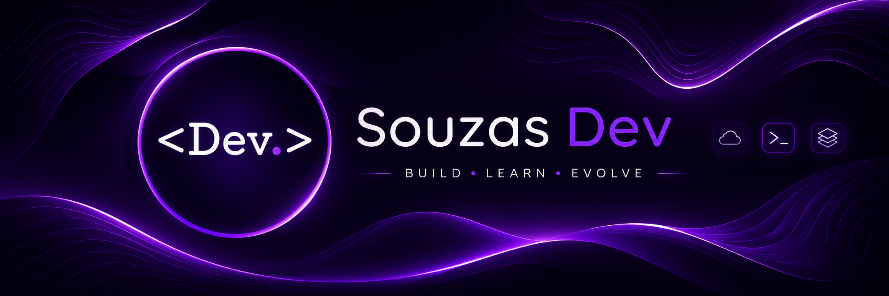

# Eduardo Souza

**Suporte Técnico · Infraestrutura · AWS · Linux · Automação**

Criador da **Souzas Dev**, minha marca pessoal de tecnologia.

Construindo projetos, explorando novas tecnologias e documentando minha evolução profissional.

**BUILD · LEARN · EVOLVE**

---

## 👋 Sobre mim

Sou Eduardo Souza e estou construindo minha trajetória na área de Tecnologia da Informação, com foco em infraestrutura, sistemas e computação em nuvem.

A **Souzas Dev** é minha marca pessoal, criada para reunir meus projetos, estudos, experiências práticas e conhecimentos em Tecnologia da Informação.

Atualmente, estudo **Cloud Computing com AWS na Escola da Nuvem (EdN)**, além de Linux, redes e automação. Também desenvolvo conhecimentos em programação e desenvolvimento web como complemento à minha formação.

Utilizo o GitHub como um portfólio técnico e um registro público da minha jornada de aprendizado.

## 🧭 Objetivo profissional

**Porta de entrada:** atuar em Suporte Técnico N1, Help Desk, Service Desk ou Infraestrutura, desenvolvendo experiência prática em diagnóstico, sistemas operacionais e atendimento técnico.

**Objetivo de longo prazo:** evoluir para Engenharia de Nuvem (Cloud Engineer), aprofundando conhecimentos em AWS, redes, Linux, segurança e automação.

## 🎯 Áreas de interesse

- **Suporte Técnico e Infraestrutura:** diagnóstico, sistemas operacionais, redes e documentação técnica.
- **Cloud Computing:** AWS, infraestrutura, redes, segurança e serviços em nuvem.
- **Linux e automação:** administração de ambientes, scripts Bash e diagnóstico.
- **Desenvolvimento web:** frontend, backend e integração de aplicações.
- **Engenharia de software:** Git, documentação, testes e boas práticas.

## 🚀 Projetos em destaque

### ☁️ AWS Labs — Laboratórios Práticos

Laboratórios de computação em nuvem com documentação técnica, scripts e evidências.

**Tecnologias:** AWS · Amazon EC2 · Amazon Linux · Bash · VPC · EBS

**Status:** Em andamento — laboratórios do curso AWS da Escola da Nuvem (EdN).

[Explorar AWS Labs](https://github.com/Souzas-Dev/AWS-Lab)

### 🐧 Ubuntu Workstation Setup

Projeto de automação para preparação de ambientes Ubuntu, com scripts, simulação de execução, logs e testes automatizados.

**Tecnologias:** Linux · Ubuntu · Bash · Git · Python

**Status:** Pausado temporariamente — aguardando ambiente Linux para novos testes.

[Explorar Ubuntu Workstation Setup](https://github.com/Souzas-Dev/ubuntu-workstation-setup)

## 🛠️ Tecnologias e ferramentas

Organizo minhas tecnologias conforme as experiências registradas, os conhecimentos explorados e meus objetivos de aprendizado. Esta classificação não representa domínio avançado de todas as ferramentas.

### Experiência prática documentada

Tecnologias utilizadas ou demonstradas nos projetos públicos deste GitHub.

| Área | Tecnologias e práticas |
| --- | --- |
| Cloud Computing | AWS, Amazon EC2, VPC, Security Groups, EBS e User Data |
| Linux e automação | Ubuntu, Amazon Linux, Bash, APT, scripts e logs |
| Python e interfaces | Python e PySide6 (Qt), em protótipo desktop |
| Versionamento | Git, GitHub, branches e Pull Requests |
| Qualidade e documentação | Testes Bash, GitHub Actions, Markdown e documentação técnica |

### Outras tecnologias do meu repertório

Tecnologias com as quais tive contato em estudos ou experiências de diferentes níveis, não necessariamente demonstradas nos repositórios públicos em destaque.

| Área | Tecnologias e ferramentas |
| --- | --- |
| Desenvolvimento web | HTML5, CSS3, JavaScript, TypeScript, React, Next.js e Tailwind CSS |
| Backend | Node.js e APIs |
| Bancos de dados | SQL, PostgreSQL, Prisma e Supabase |
| Testes e qualidade | Vitest, Zod e ESLint |
| Sistemas e automação | Windows e PowerShell |
| Publicação | Vercel e GitHub Pages |

### Conhecimentos em aprofundamento

- **Cloud Computing:** AWS, infraestrutura, redes, segurança e monitoramento.
- **Suporte e infraestrutura:** sistemas operacionais, redes e diagnóstico de problemas.
- **Linux:** administração de ambientes e automação com Bash.
- **Programação:** Python, desenvolvimento web e boas práticas de software.

Meu foco é consolidar os fundamentos por meio de estudos, laboratórios e projetos práticos, documentando resultados e limitações de cada atividade.

## 📚 Aprendizado contínuo

Minha abordagem de aprendizado é baseada em três pilares:

1. **Estudar:** compreender conceitos e fundamentos.
2. **Praticar:** aplicar conhecimentos em projetos e laboratórios.
3. **Documentar:** registrar decisões, resultados, dificuldades e melhorias.

Acredito que a evolução técnica acontece quando transformamos conhecimento em experiência prática.

---

### BUILD · LEARN · EVOLVE

**Souzas Dev**

Marca pessoal de Eduardo Souza.

*Construindo hoje. Aprendendo sempre. Evoluindo a cada projeto.*

